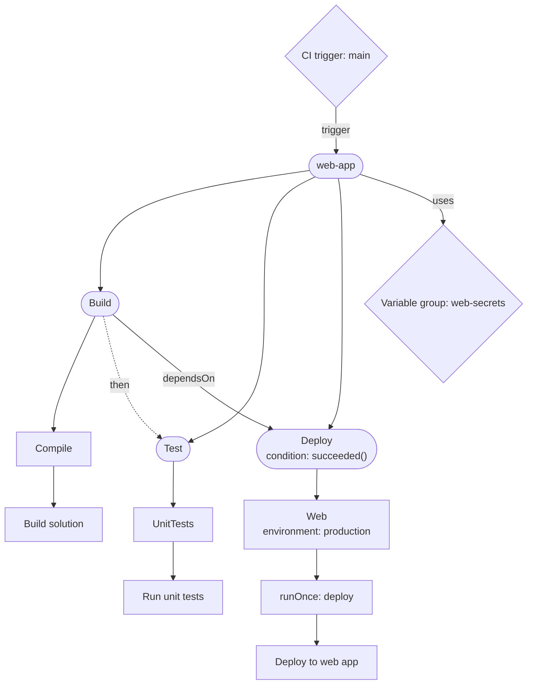

# ado-pipeline-graph

ado-pipeline-graph renders Azure DevOps Services pipeline YAML as Mermaid diagrams. It reads one pipeline file, or every pipeline under a directory, and writes a Mermaid flowchart, a standalone HTML viewer and a Markdown description. Local files are the default and need no network access. An opt-in REST mode reads pipeline YAML, run history and variable groups from Azure DevOps Services. The tool never evaluates or runs pipeline expressions.

Requires Python 3.10 or later (`requires-python` in `pyproject.toml`). The only runtime dependency is PyYAML.

The project is not published to PyPI.

## Install

```sh
pipx install git+https://github.com/rbby/azdo-graph
# or
uv tool install git+https://github.com/rbby/azdo-graph
# or run without installing (pin a tag once releases exist: ...azdo-graph@v0.1.0)
uvx --from git+https://github.com/rbby/azdo-graph ado-pipeline-graph --scan-root . --out-dir ado-graph
```

From a checkout of the repository:

```sh
pipx install .
# or
uv tool install .
```

## Quick start

Save this file as `azure-pipelines.yml`:

```yaml
name: web-app

trigger:
  branches:
    include:
      - main

variables:
  - group: web-secrets

stages:
  - stage: Build
    jobs:
      - job: Compile
        steps:
          - script: dotnet build
            displayName: Build solution

  - stage: Test
    jobs:
      - job: UnitTests
        steps:
          - script: dotnet test
            displayName: Run unit tests

  - stage: Deploy
    dependsOn: Build
    condition: succeeded()
    jobs:
      - deployment: Web
        environment: production
        strategy:
          runOnce:
            deploy:
              steps:
                - script: ./deploy.sh
                  displayName: Deploy to web app
```

Run:

```sh
ado-pipeline-graph azure-pipelines.yml
```

The default output is Mermaid source on stdout:



Paste the source into any Mermaid renderer, or use the HTML output described below.

## Usage

### Single pipeline

```sh
ado-pipeline-graph [PIPELINE] [-o FILE [--html]] [options]
```

`PIPELINE` defaults to `azure-pipelines.yml` in the current directory. Without `-o` or `--out-dir`, the Mermaid source is written to stdout.

```sh
ado-pipeline-graph pipelines/web.yml -o web.mmd
ado-pipeline-graph pipelines/web.yml -o web.html --html
```

### Output folder (`--out-dir DIR`)

`--out-dir DIR` creates `DIR` if needed and writes three files into it. The file name `<name>` depends on the mode:

| Mode | `<name>` |
|---|---|
| Single local file | The file's path relative to its repository root, without the extension, with `/` replaced by `-`. `pipelines/web.yml` becomes `pipelines-web`. If no `.git` directory is found above the file, the name is the file name without the extension. |
| `--scan-root` | `repository` |
| `--rest --pipeline-id N` | `pipeline-N` |

The files are `<name>.html` (viewer), `<name>.md` (description with the diagram) and `<name>.mmd` (Mermaid source). The tool prints the three paths. `--out-dir` cannot be combined with `-o`. It can appear before or after the pipeline path.

```sh
ado-pipeline-graph azure-pipelines.yml --out-dir ado-graph
```

### Repository scan (`--scan-root PATH`)

`--scan-root` walks each given directory and builds one combined graph of all pipelines it finds. It is repeatable. A scan root may also be a single `.yml` or `.yaml` file.

```sh
ado-pipeline-graph --scan-root . --exclude 'tests/*' --out-dir ado-graph
```

What the scan does:

- Reads `.yml` and `.yaml` files. It does not descend into directories named `.git`, `.venv`, `venv`, `node_modules`, `.github`, `.tox`, `dist`, `build`, `__pycache__` or `ado-graph`.
- Treats a file as a pipeline when its name starts with `azure-pipelines` (case-insensitive), or it has a `trigger`, `pr`, `schedules` or `extends` key, or it has a top-level `stages`, `jobs` or `steps` list.
- Leaves a file out, without a message, when another scanned file references it as a template, when it looks like a GitHub Actions workflow (an `on` key or a `jobs` mapping), or when it looks like a Compose or Kubernetes file (a `services` key, or `apiVersion` with `kind`).
- Shows templates and variable groups that several pipelines use as one shared node each.
- Reports a file on stderr and continues when the file is not valid YAML, is not a mapping at the root (this includes multi-document files), cannot be read, or fails template expansion (for example a recursive template reference).

`--exclude GLOB` is repeatable. A glob is matched with `fnmatch` against the file path relative to the scan root, using `/` as the separator. Excluded files are not read at all. `--strict` stops at the first unusable file and exits with status 2. Without `--strict`, the scan prints the skipped files and their reasons on stderr.

### Template roots (`--template-root ALIAS=PATH`)

`--template-root` maps a repository alias to a local checkout, so templates in another repository can be read. It is repeatable.

```sh
ado-pipeline-graph azure-pipelines.yml --template-root sharedTemplates=../shared-templates
```

With that option, `template: jobs/build.yml@sharedTemplates` is read from `../shared-templates/jobs/build.yml`. Without a mapping, an aliased template is shown as an unresolved node and is not expanded.

Templates without an alias resolve as follows:

- A path starting with `/` resolves from the repository root (the nearest ancestor with a `.git` directory).
- Any other path resolves from the directory of the file that references it.

A resolved template must stay inside the repository root, or inside the alias checkout for aliased templates. Otherwise it is treated as unresolved.

### Detail and direction (`--detail`, `--direction`)

`--detail` sets how much of the pipeline is shown:

- `stages`: pipeline stages and expression blocks.
- `jobs`: adds jobs.
- `steps`: adds steps and deployment hooks. This is the default for a single pipeline.

The default is `jobs` with `--scan-root`. Triggers, resources, templates and variable groups appear at every level.

`--direction TD` (top to bottom, the default) or `LR` (left to right) sets the layout. Both options apply to all three output files.

### Offline HTML viewer (`-o FILE --html`, `--mermaid-js PATH`)

`-o FILE --html` writes one standalone HTML page with a legend, zoom controls and the Mermaid source below the diagram. `--out-dir` always writes an HTML page as well.

The page draws the diagram in the browser with Mermaid, which it loads from `https://cdn.jsdelivr.net` (Mermaid 11.15.0, set in `core.py`). **Without `--mermaid-js`, the HTML needs internet access to draw the diagram.** Without internet, the page shows the error "Could not render the diagram" and the Mermaid source.

For offline viewing, download a `mermaid.min.js` file and pass it with `--mermaid-js`:

```sh
ado-pipeline-graph azure-pipelines.yml -o web.html --html --mermaid-js ./mermaid.min.js
```

The file is inlined into the page. If the page already has `window.mermaid`, that copy is used instead of the CDN. `--mermaid-js` only affects HTML output.

### REST mode (`--rest`)

REST mode reads pipelines from Azure DevOps Services. It needs two environment variables:

- `ADO_ORG_URL`: the organisation URL, for example `https://dev.azure.com/my-organization`. It must start with `https://`.
- `ADO_PAT`: a personal access token.

The PAT is read only from `ADO_PAT`. There is no option that accepts it, and the tool does not print it. Redirects are followed only over HTTPS, and the `Authorization` header is dropped when a redirect points to a different host.

```sh
export ADO_ORG_URL=https://dev.azure.com/my-organization
export ADO_PAT=...   # set this in your shell or secret store, not in a file in the repository
ado-pipeline-graph --rest --project MyProject --pipeline-id 42 -o pipeline.mmd
```

REST options:

- `--project` is required with `--rest`.
- `--pipeline-id` selects one pipeline definition. It is required unless `--scan-root` is used.
- `--branch` selects the branch to read. It applies only to single-pipeline mode and is ignored with `--scan-root`.
- `--runs` sets how many recent runs are read (default 20).
- `--api-version` sets the REST API version (default 7.1).
- `--timeout` sets the request timeout in seconds (default 30).
- `--no-expand` is described below.

Options that only make sense with REST (`--project`, `--pipeline-id`, `--branch`, `--runs`, `--api-version`, `--timeout`, `--no-expand`) are rejected without `--rest`.

**Single pipeline.** By default the tool calls the Pipelines Preview API (`POST .../pipelines/{id}/preview` with `previewRun: true`). The service expands the templates, so the diagram shows the expanded YAML. This is a dry run: it does not queue a build. The tool's own error message says the call needs a PAT with **build** scope.

If that call is denied, the tool prints a hint and exits with status 2. It does not fall back to local files. Use `--no-expand` to read the raw YAML of the pipeline's configured repository and path instead. Templates then stay unresolved, although `--template-root` still resolves aliased templates. Use `--no-expand` for PATs without build scope.

The diagram also shows recent runs: a pipeline that triggered this one appears as `Triggered by: <name>` with a count of runs.

**Repository scan.** `--rest --project MyProject --scan-root .` lists the project's pipeline definitions and matches each definition's YAML path to a local file by path components. Matches are counted on stderr, along with ambiguous and unmatched definitions. Run history for matched definitions adds `triggered (N of M runs)` edges between pipelines in the local graph. `--exclude` and `--strict` apply as they do without REST. `--pipeline-id` cannot be combined with `--scan-root`.

**Errors.** REST failures exit with status 2 and a message on stderr. Requests that get HTTP 429, 502, 503 or 504 are retried up to three times, honouring `Retry-After`.

**Permissions.** The tool's messages name build scope for the preview call only. The other calls read pipeline definitions, repository items, builds and variable groups. This document does not list the scopes for those calls. Check the Microsoft documentation for each endpoint, and use the shortest expiry you can.

## Option reference

Output of `ado-pipeline-graph --help`, with the defaults from the source:

| Option | Default | Description |
|---|---|---|
| `pipeline` | `azure-pipelines.yml` | Pipeline YAML file (local mode only). |
| `-o OUTPUT`, `--output OUTPUT` | stdout | Write the diagram to a file. |
| `--out-dir DIR` | none | Write `.html`, `.md` and `.mmd` files into `DIR`. Cannot be combined with `-o`. |
| `--html` | off | With `-o`, write a standalone HTML viewer. |
| `--detail {stages,jobs,steps}` | `steps` (`jobs` with `--scan-root`) | Level of detail. |
| `--direction {TD,LR}` | `TD` | Graph direction. |
| `--mermaid-js PATH` | none | Local `mermaid.min.js` to inline into the HTML, for offline viewing. |
| `--template-root ALIAS=PATH` | none | Map a repository alias to a local template checkout. Repeatable. |
| `--scan-root PATH` | none | Scan YAML files under this path and build a combined graph. Repeatable. |
| `--exclude GLOB` | none | With `--scan-root`, skip files whose path relative to the scan root matches. Repeatable. |
| `--strict` | off | With `--scan-root`, fail on the first unusable file. |
| `--rest` | off | Use Azure DevOps Services REST APIs. |
| `--project PROJECT` | none | Azure DevOps project name (required with `--rest`). |
| `--pipeline-id PIPELINE_ID` | none | Pipeline definition ID (REST single-pipeline mode). |
| `--branch BRANCH` | the repository's default branch with `--no-expand` | Branch to retrieve in REST single-pipeline mode. |
| `--runs RUNS` | `20` | Maximum run records to retrieve in REST mode. |
| `--api-version API_VERSION` | `7.1` | Azure DevOps REST API version. |
| `--timeout SECONDS` | `30` | REST request timeout. |
| `--no-expand` | off | REST single-pipeline mode: use the raw YAML file instead of the service-expanded YAML. For PATs without build scope. |
| `--install-skill {user,project}` | none | Install the Claude Code skill and exit (see below). |
| `-h`, `--help` | | Show help and exit. |
| `--version` | | Show the version and exit. |

Diagnostics (skipped files, REST hints and scan counts) go to stderr. The diagram goes to stdout or to the file you name.

## Reading the diagram

The renderer assigns a shape to each node kind:

- Rounded box: repository, pipeline or stage.
- Plain box: job, step or deployment hook. Hooks are labelled such as `runOnce: deploy`.
- Diamond: trigger, resource, `${{ if }}` / `${{ elseif }}` / `${{ else }}` block (condition), `${{ each }}` block (loop), template, or variable group.
- Dashed outline: a template that could not be resolved, so its content is not shown.

Node labels show the title and, on a second line, `environment:`, `matrix:`, `parallel:` or `condition:` when the YAML sets them. A step shows only its title and those lines, not the script body. Long labels are shortened.

Edges:

- A solid arrow from a parent to a child shows containment, such as a stage to its jobs. Steps in a job are chained in order, so an arrow from one step to the next shows execution order.
- Labelled solid arrows: `dependsOn` (explicit stage or job dependency), `uses` (a pipeline uses a template or variable group), `trigger` (a trigger or resource starts the pipeline), `resource`, and `trigger (N of M runs)` (observed run history).
- Dashed arrows: `then` shows implicit stage order, where a stage with no `dependsOn` follows the previous stage. A dashed arrow also starts at every condition or loop block, into the block's contents and on to the item after it. Every branch of a condition is shown; the tool does not decide which branch runs.

## Limitations

- **Expressions are never evaluated.** Conditions and loops are shown as written, and every branch is shown.
- **Only literal values are substituted.** Only `${{ parameters.x }}` and `${{ variables.x }}` are replaced, and only when the value is a literal in scope. `$(var)` macros, `parameters['x']`, runtime expressions and all other expressions are left as written.
- **Scoping.** Each file sees its own declared parameter defaults overlaid with the values its caller passed. A template sees the variables in scope at its caller, overridden by its own top-level variables.
- **Templates.** Only local files and `--template-root` checkouts are read. Other templates are unresolved. Resolution never leaves the repository root (or the alias checkout).
- **Multi-document YAML is not supported.** Such files are rejected.
- **Variable groups** are found from `- group:` entries under `variables`. In REST mode, the group's ID is shown when the project's group list has it.
- **Azure DevOps Services only.** Azure DevOps Server is not supported.
- **REST behaviour is unverified.** The REST code is implemented from the Microsoft documentation. It has not been checked against a live organisation.

## Troubleshooting

- `ADO_ORG_URL must be set for REST mode` or `ADO_PAT must be set for REST mode`: export the variable in the same shell.
- `ADO_ORG_URL must start with https://`: the organisation URL must use HTTPS.
- `authentication failed; check ADO_PAT` (HTTP 401), or a message about a sign-in page: the PAT is missing, invalid or expired.
- `access denied; check project and pipeline permissions` (HTTP 403): the PAT's user or scopes cannot read the project or pipeline.
- `the template preview call was denied`: the PAT has no build scope. Use `--no-expand`.
- `could not reach Azure DevOps` or `timed out`: check the network, or raise `--timeout`.
- `skipped N file(s)` on stderr: fix those files, or exclude them with `--exclude`.
- `Could not render the diagram` in the HTML: usually the browser could not load Mermaid from the CDN, which happens without internet access. Use `--mermaid-js`.
- A diagram that is too large to read: use `--detail stages`.

## Claude Code skill

`--install-skill` copies the bundled skill into a Claude Code skills directory, then exits:

```sh
ado-pipeline-graph --install-skill user      # ~/.claude/skills/ado-pipeline-graph/SKILL.md
ado-pipeline-graph --install-skill project   # ./.claude/skills/ado-pipeline-graph/SKILL.md
```

With `user`, the directory `CLAUDE_SKILLS_DIR` is used in place of `~/.claude/skills` when it is set. The command overwrites an existing `SKILL.md` without asking. The skill tells Claude Code how to run the CLI, to write the output to `ado-graph/`, and to report the printed paths.

## Development

```sh
python -m pip install -e '.[dev]'
pytest
ruff check .
ruff format --check .
mypy ado_pipeline_graph
```

CI (`.github/workflows/ci.yml`) runs `ruff check`, `ruff format --check` and `mypy` on Python 3.12, runs `pytest --cov` on Python 3.10 to 3.13 on Ubuntu and Windows, and builds the package with `python -m build` and `twine check`.

See [CONTRIBUTING.md](CONTRIBUTING.md) for the setup, test and golden-file workflow. Design notes are in [docs/design.md](docs/design.md). Report security issues as described in [SECURITY.md](SECURITY.md). The changes made so far are listed in [CHANGELOG.md](CHANGELOG.md).

## Licence

MIT. See `LICENSE`.
