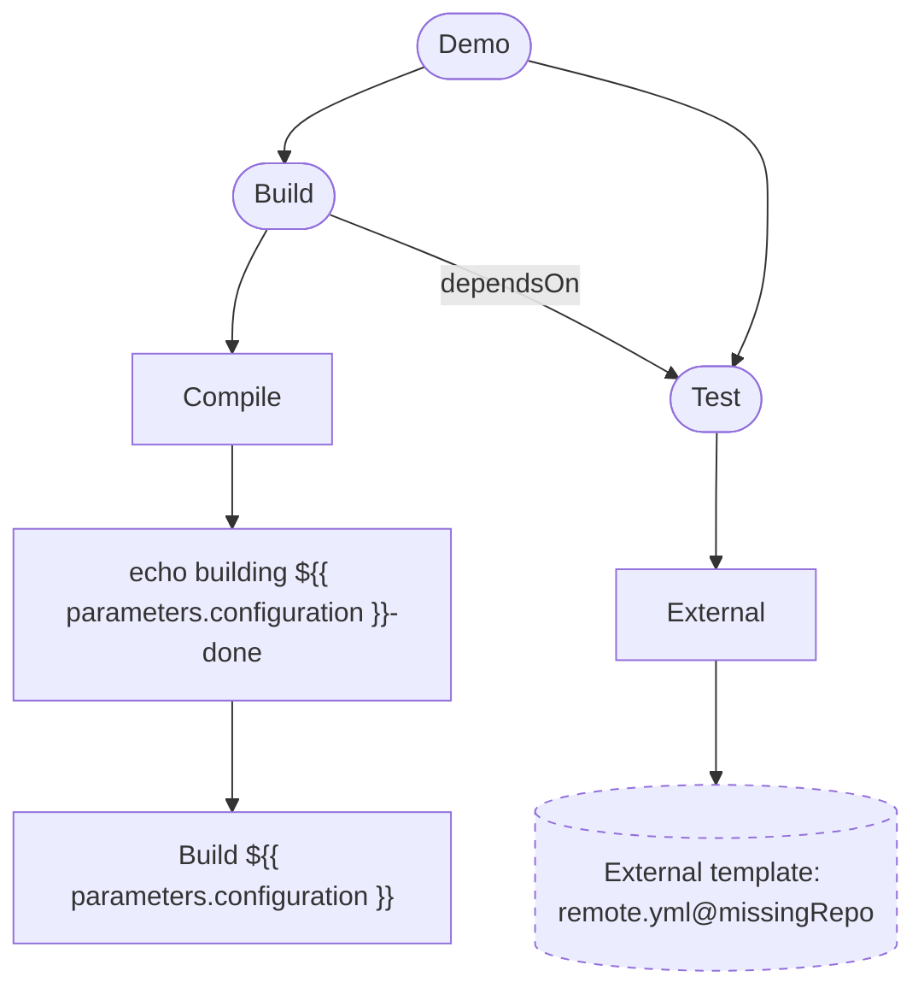

# Demo

## Overview

- Name: Demo
- Stages: 2
- Jobs: 2
- Steps: 2

## Stages

- Stage: **Build**
  - Job: **Compile**
    - Step: echo building ${{ parameters.configuration }}-done
    - Step: Build ${{ parameters.configuration }}
- Stage: **Test** (depends on Build)
  - Job: **External**
    - Unresolved template `remote.yml@missingRepo`

## Templates used

- `tests/fixtures/local/compile-step.yml`
- `tests/fixtures/local/templates/build-job.yml`
- `remote.yml@missingRepo` (unresolved, not expanded)

## Diagram

---

_This file is generated by ado-pipeline-graph from the pipeline YAML. Pipeline expressions are not evaluated; conditions and templates are shown as written._
